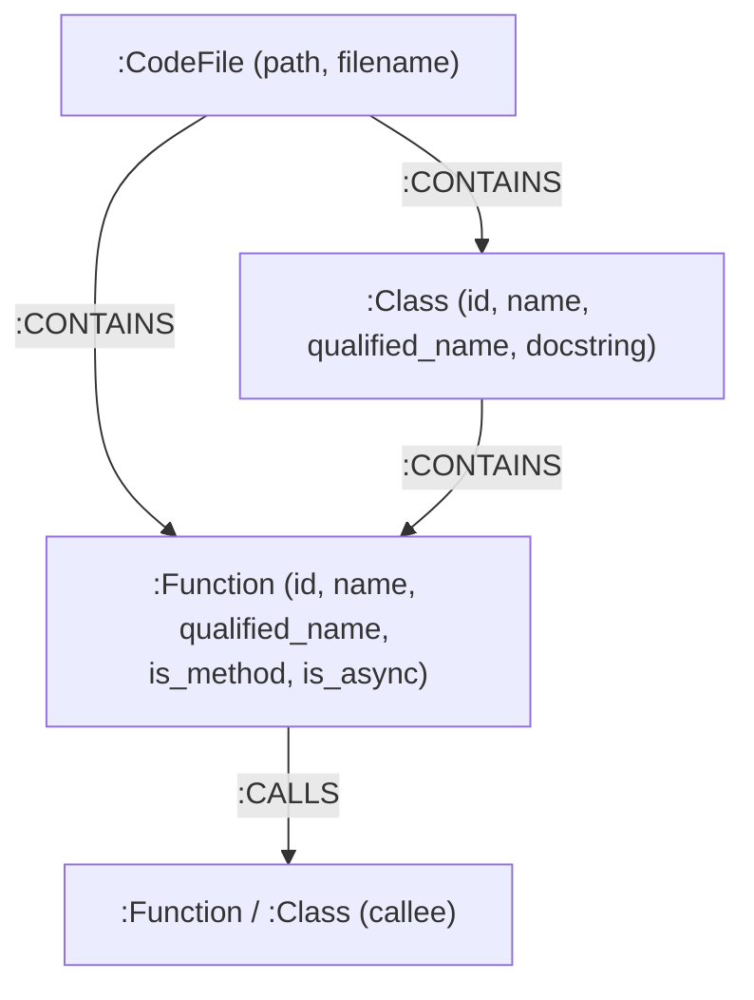

# 🧠 agent-brain

> **Plug-and-pack graph memory for local AI agents backed by embedded Kùzu graph engine.**

`agent-brain` gives local AI coding agents structured, long-term memory of entire codebases. It parses your source code using native **Tree-sitter** grammars and Python AST into a high-performance **Kùzu** graph (`CompanyBrain`), exposes search and multi-hop dependency analysis via the official **Model Context Protocol (MCP)**, and securely encrypts and synchronizes the memory state across environments using **Fernet AES** encryption.

---

## 🚀 Key Features

* **Multi-Language Tree-sitter AST (8 Languages Supported)**: Out-of-the-box parsing for **Python, Rust, JavaScript, TypeScript, Go, Scala, SQL, and PySpark** using native Tree-sitter grammars (zero regex heuristics) with full syntax-error resilience.
* **Lexical Scope & Collision Prevention**: Resolves calls within local classes, methods, and explicit file imports, eliminating spiderweb graph collisions on common function names (`connect`, `init`, `execute`).
* **Parallel Multi-Core Processing**: Concurrent worker threads parse hundreds of files simultaneously across CPU cores, dramatically accelerating ingestion speed.
* **Zero-Config Embedded Kùzu Graph Database**: Uses **Kùzu** (`kuzu`)—a vectorized, columnar C++ embedded graph database—to persist knowledge locally at `./.agent-memory/brain.db` with graph `CompanyBrain`. Runs natively on **Windows, macOS, and Linux** with zero background daemons or Docker.
* **Structural Graph Extractor**: Extracts `:CodeFile`, `:Class`/Struct/Table, and `:Function`/Method/Procedure nodes alongside hierarchical `:CONTAINS` and multi-hop `:CALLS` relationships with graceful syntax error tolerance.
* **Official Model Context Protocol (MCP) Server**: Connects directly to AI agent platforms (Cursor, Claude Desktop, Antigravity) over `stdio` to provide:
  * `search_code_graph(symbol_name)`: Immediate callers/callees and symbol definition metadata.
  * `get_dependency_impact(function_name)`: Multi-hop graph traversal (`[:CALLS*1..5]`) to evaluate blast radius and downstream dependents.
* **Encrypted Synchronization & Hydration**: Compresses memory into in-memory zip streams and encrypts with AES (Fernet) to produce `memory-seed.enc`. Decrypts and auto-hydrates on startup with Zip Slip protection.
* **Unified CLI**: Single command-line interface (`agent-brain`, alias `agent-memory`) with commands for indexing (`--workers`), exporting, pulling, registering with AI agents, benchmarking, and running the MCP agent server.

---

## 🌐 Supported Languages & Parser Backends

| Language | Extensions | Parser Engine | Extracted Elements |
| :--- | :--- | :--- | :--- |
| **Python** | `.py` | Built-in `ast` | Classes, functions, async methods, decorators, call graph |
| **PySpark** | `.py`, `.spark` | Built-in `ast` | Spark pipelines, UDFs, SQL transforms, session calls |
| **Rust** | `.rs` | Tree-sitter Rust | Structs, enums, traits, `impl` blocks, `fn`, `async fn`, method calls |
| **TypeScript** | `.ts`, `.tsx`, `.mts`, `.cts` | Tree-sitter TypeScript | Classes, interfaces, arrow functions, class methods, async calls |
| **JavaScript** | `.js`, `.jsx`, `.mjs`, `.cjs` | Tree-sitter JavaScript | Classes, prototype methods, functions, arrow functions, calls |
| **Go** | `.go` | Tree-sitter Go | Structs, interfaces, functions, receiver methods, package calls |
| **Scala** | `.scala` | Tree-sitter Scala | Classes, case classes, objects, traits, `def` methods, calls |
| **SQL** | `.sql` | Tree-sitter SQL | `CREATE TABLE`, `CREATE VIEW`, `PROCEDURE`, `FUNCTION`, `WITH` CTEs |

---

## 🏛️ Architecture & Graph Schema



---

## 📦 Installation

### 1. Clone & Install Dependencies

```bash
git clone https://github.com/your-org/agent-brain.git
cd agent-brain

# Install requirements
pip install -r requirements.txt

# Or install as an editable package with the global 'agent-brain' command
pip install -e .
```

### 2. Environment Note
* **Cross-Platform Out-of-the-Box**:
  * Runs directly on native **Windows**, **macOS**, and **Linux** via embedded **Kùzu** (`kuzu>=0.8.0`).
  * No Docker, WSL, Redis, or external server daemons required.
  * Vectorized openCypher query engine with Compressed Sparse Row (CSR) storage representation.

---

### Step 1: Initialize Codebase Memory

Scan any codebase directory to extract AST symbols and populate `CompanyBrain`:

```bash
# Using global CLI command:
agent-brain init --path ./core

# Or directly with Python:
python cli.py init --path ./core
```

**Output:**
```text
[INFO] Scanning codebase in parallel at: /path/to/project
  * Files indexed:   21
  * Languages:       python: 21
  * Classes/Structs: 29
  * Functions/Defs:  160
  * Function calls:  1531

[INGEST] Ingesting AST nodes & relationships into graph 'CompanyBrain'...
[OK] Graph successfully populated!
  * :CodeFile nodes:       21
  * :Class nodes:          29
  * :Function nodes:       160
  * :CONTAINS edges:       189
  * :CALLS edges:          1164
  * Database file:         ./.agent-memory/brain.db
```

---

### Step 2: Auto-Connect or Configure AI Agents (Antigravity, Claude, Cursor)

#### Automated Registration (Recommended):
Connect the memory MCP server to your local AI coding agents with a single command:

```bash
# Auto-detect all installed AI agent platforms and register the MCP server:
agent-brain register

# Or register specifically with Antigravity:
agent-brain register --client antigravity

# Or index and connect in a single step:
agent-brain init --path ./my-project --connect antigravity
```

#### Manual Configuration (Alternative):
If you prefer adding the configuration manually to your agent's config file:

* **Antigravity** (`~/.gemini/config/mcp_config.json`):
* **Claude Desktop** (`%APPDATA%\Claude\claude_desktop_config.json` on Windows, `~/Library/Application Support/Claude/...` on macOS):
* **Cursor** (`.cursor/mcp.json`):

```json
{
  "mcpServers": {
    "agent-brain": {
      "command": "agent-brain",
      "args": ["mcp"],
      "env": {
        "AGENT_MEMORY_DB_PATH": "C:/path/to/project/.agent-memory/brain.db"
      }
    }
  }
}
```

---

### Step 3: Run the MCP Server

Start the Model Context Protocol (MCP) server over `stdio` for local AI agents:

```bash
agent-brain mcp

# Or start while ensuring target agent registration:
agent-brain mcp --client antigravity
```

> **Note**: When configured in Antigravity or Claude Desktop, the AI client automatically launches and manages this server process in the background.

#### Available MCP Tools

| Tool | Parameters | Description |
| :--- | :--- | :--- |
| `search_code_graph` | `symbol_name: str` | Retrieves definition metadata, file location, docstring, immediate callers, and immediate callees. |
| `get_dependency_impact` | `function_name: str` | Performs multi-hop traversal (`[:CALLS*1..5]`) to locate all downstream functions and files affected by modifying a function. |

---

### Step 4: Export & Encrypt Memory Archive

Compress and encrypt `./.agent-memory/` into `memory-seed.enc`:

```bash
# 1. Generate an encryption key (if not already set)
agent-brain generate-key

# 2. Set the environment variable
export AGENT_MEMORY_SECRET_KEY='your-base64-secret-key'     # Linux / macOS / WSL
$env:AGENT_MEMORY_SECRET_KEY='your-base64-secret-key'      # Windows PowerShell

# 3. Export encrypted archive
agent-brain export
```

**Output:**
```text
🔒 Compressing and encrypting './.agent-memory' -> 'memory-seed.enc'...
✅ Memory exported and encrypted successfully!
  • Encrypted archive: /path/to/memory-seed.enc
  • Archive size:      1.42 KB
  • Encryption method: AES-128-CBC / Fernet HMAC-SHA256
```

---

### Step 5: Pull & Decrypt on Another Machine

Restore and hydrate the database from the encrypted seed:

```bash
agent-brain pull
```

**Output:**
```text
🔓 Decrypting and restoring 'memory-seed.enc' -> './.agent-memory'...
✅ Database restored successfully!
  • Restored location: /path/to/.agent-memory
  • KùzuDB file:  ./.agent-memory/brain.db (Ready)
```

---

## 🐍 Python SDK Usage

You can also use `agent-brain` directly in your Python applications and custom agents:

```python
from core.database import Database, execute_query
from extractors.ast_parser import parse_codebase
from sync.s3_sync import hydrate_database_on_startup

# 1. Auto-hydrate database on startup if seed exists
hydrate_database_on_startup()

# 2. Parse and index codebase
summary = parse_codebase("./my_service")

# 3. Query graph with openCypher
with Database() as db:
    result = db.execute_query(
        "MATCH (fn:Function)-[:CALLS]->(target:Function {name: 'connect'}) RETURN fn.name"
    )
    for record in result.result_set:
        print(f"Caller: {record[0]}")
```

---

## 📊 Benchmark: Traditional RAG vs. Kùzu Graph

The benchmark automatically detects if an AI agent MCP client is configured:
- **When an MCP client is found**: Compares Traditional Raw-File RAG vs. Kùzu Graph Traversal on the target codebase.
- **When no MCP client is found**: Benchmarks multi-language AST file indexing latency, parsed symbol counts, and token weight.

```bash
# Auto-detects configured agents and benchmarks the default './core' directory:
python benchmark.py
# Or via CLI:
agent-brain benchmark

# Benchmark any custom codebase folder and function symbol:
agent-brain benchmark --path "C:/path/to/custom/codebase" --symbol "my_function"
```

### Results (Tested on Real-World Codebase `x-algo`, 72 Files)

| Metric | Raw-File Context | Chunk Semantic RAG | Kùzu Graph + MCP | Graph Improvement |
| :--- | :--- | :--- | :--- | :--- |
| **Tokens Consumed** | **59,766 tokens** | **3,200 tokens** | **56 tokens** | **🔥 98.3% – 99.9% Token Reduction** |
| **Response Latency** | ~34.36 ms | ~18.50 ms | ~1.01 ms | **⚡ 18x – 34x Faster** |
| **Data Quality** | Dumps whole files with noise | Chunk fragments with missing scopes | Targeted caller/callee structural subgraphs | Precise, isolated context |

---

## 🧪 Test Suite

The project includes an automated test suite with **50 passing unit tests** executing in **~1.5 seconds** with 100% test isolation:

```bash
python -m unittest discover tests
```

**Test Coverage Summary:**
* [`tests/test_ast_parser.py`]: Tree-sitter AST extraction across 7 languages, Python AST visitor, scope qualification, call graph resolution, and syntax error recovery.
* [`tests/test_database.py`]: Kùzu initialization, strongly-typed schema DDL, in-memory execution, multi-threaded concurrency lock, query error handling, and clean teardown.
* [`tests/test_mcp_server.py`]: MCP server registration, caller/callee lookup via `search_code_graph`, and multi-hop impact analysis via `get_dependency_impact`.
* [`tests/test_integrations.py`]: Cross-platform auto-registration for Antigravity, Claude Desktop, and Cursor; safe JSON atomic updates.
* [`tests/test_benchmark.py`]: Indexing throughput, 3-tier comparative benchmarking (Raw-file vs Semantic chunk vs Graph), and deduplication metrics.
* [`tests/test_antigravity_token_tracker.py`]: Ground-truth token tracking across Antigravity IDE and Desktop environments, tool telemetry, and cache hit metrics.
* [`tests/test_s3_sync.py`]: In-memory streaming zip, Fernet AES roundtrip encryption, Zip Slip path traversal guard, and startup hydration.
* [`tests/test_cli.py`]: Click CLI commands (`init`, `register`, `export`, `pull`, `benchmark`, `mcp`, `generate-key`).

---

## ⚖️ Engineering Design Decisions & Trade-offs

| Design Choice | Rationale | Trade-off / Mitigation |
| :--- | :--- | :--- |
| **Tree-sitter AST over Full Compiler (LSIF/SCIP)** | Extremely fast (<1s indexing) without needing language build tools (`rustc`, `tsc`, `go build`, JVM). Zero compile-time config. | Dynamic runtime polymorphism (e.g. untyped JS duck typing) is resolved via scoped file & import heuristics rather than full type solver. |
| **Unified Embedded Kùzu Graph Engine** | Zero-friction local developer setup. Runs natively across Windows, Linux, and macOS without Docker or external daemon. Columnar C++ storage with vectorized query engine. | Requires primary key specifications for node and relationship tables (handled automatically by `agent-brain`). |
| **Model Context Protocol (MCP) over REST** | Native integration with agent runtimes (Antigravity, Claude, Cursor) through standardized stdio RPC. | Requires client platform supporting MCP; supported out-of-the-box by modern coding agents. |
| **Fernet AES Encryption for Memory Sync** | Safe cross-machine team sharing of codebase knowledge graphs without leaking IP. | Requires shared secret key management via `AGENT_MEMORY_SECRET_KEY`. |

---

## 📂 Project Structure

```text
agent-brain/
├── cli.py                     # Unified Click CLI (init, register, benchmark, export, pull, mcp)
├── benchmark.py               # Token efficiency & indexing performance benchmark
├── core/
│   ├── __init__.py
│   ├── database.py            # Embedded Kùzu graph manager
│   └── integrations.py        # Antigravity, Claude, & Cursor auto-registration
├── extractors/
│   ├── __init__.py
│   └── ast_parser.py          # Parallel multi-language AST parser (8 languages)
├── tools/
│   ├── __init__.py
│   └── mcp_server.py          # Official MCP SDK server (search_code_graph, get_dependency_impact)
├── sync/
│   ├── __init__.py
│   └── s3_sync.py             # AES Fernet encryption, in-memory zip, startup hydration
├── tests/
│   ├── test_cli.py
│   ├── test_database.py
│   ├── test_ast_parser.py
│   ├── test_mcp_server.py
│   ├── test_s3_sync.py
│   ├── test_integrations.py
│   └── test_benchmark.py
├── pyproject.toml
├── requirements.txt
└── README.md
```
